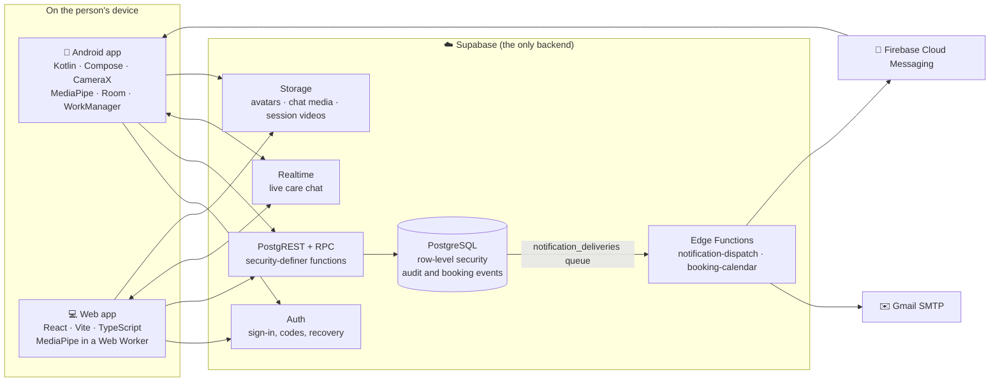
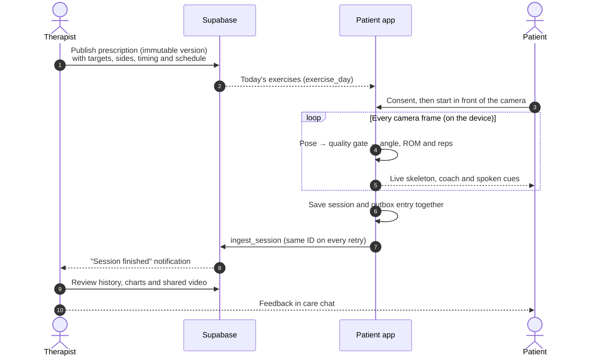
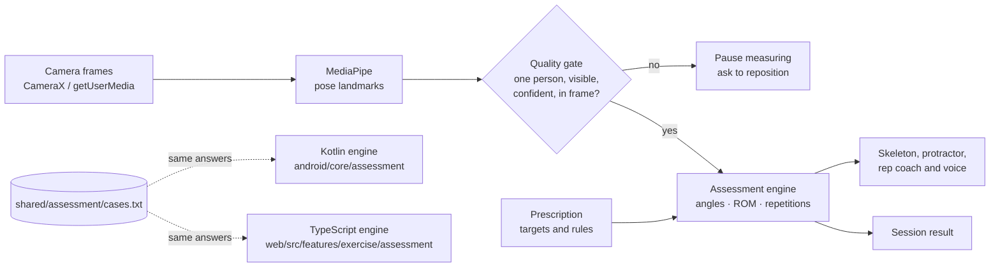
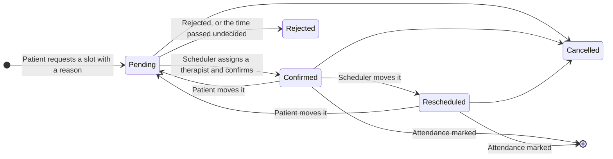
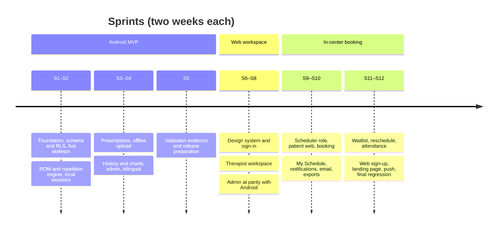

# Motivance

**Camera-guided rehabilitation for in-center physical therapy.** A patient exercises in front of a phone or laptop camera. Motivance draws their skeleton live, measures joint angles, range of motion (ROM) and repetitions, and coaches them against the targets their therapist set. Results go to the therapist, and the center books in-person sessions in the same system.

| | |
| --- | --- |
| **Apps** | Native Android app (Kotlin, Jetpack Compose) and a web workspace (React, TypeScript) |
| **Backend** | Supabase only: PostgreSQL with row-level security, Auth, Realtime, Storage and Edge Functions |
| **Languages** | English and Filipino throughout |
| **Privacy** | Pose detection runs on the device, so camera frames and landmarks never leave it |

> [!IMPORTANT]
> Motivance supports professional review. It does not diagnose. Measurement accuracy, therapist review and physical-device checks are deferred follow-up work, listed in the [post-implementation checklist](docs/validation/POST-IMPLEMENTATION-CHECKLIST.md). They have not been executed, so nothing here is clinically validated.

This README is the entry point. Each section links to the document that owns the details.

---

## Who uses it

Four roles share one sign-in. The workspace a person sees comes from their role.

| Role | What they do | Android | Web |
| --- | --- | :---: | :---: |
| **Patient** | Does prescribed exercises with the camera, follows their exercise schedule, sees progress, books and moves in-center sessions, joins waitlists, messages their therapist | ✅ | ✅ |
| **Therapist** | Invites and links patients, prescribes exercises (built-in or their own single-joint ones), sets schedules and rest days, reviews history, charts and shared session videos, marks attendance, chats with patients | ✅ | ✅ |
| **Scheduler** | Confirms booking requests, assigns therapists, runs the center calendar (hours, holidays, closures, time off), books weekly courses, exports the schedule | Notifications only | ✅ |
| **Administrator** | Manages accounts, roles, therapist-patient links, the exercise catalogue and the activity feed | ✅ | ✅ |

Administrators have the same capabilities on both apps. `scripts/check_admin_parity.py` enforces this rule, and [ADMIN-PARITY.md](docs/architecture/ADMIN-PARITY.md) lists every capability.

---

## How the system fits together



- **Clients never write tables directly.** Every change goes through a database function that re-checks the caller. Row-level security decides who can read what.
- **The web app holds only the publishable key.** Anything that needs a secret runs in `supabase/functions/`.
- **Notifications come from an event log.** Triggers on booking, exercise and chat changes write notifications, and a queue delivers email and push with retries. Push stays off until Firebase credentials are added.

More detail: [system architecture](docs/PLAN.md#system-architecture) · [database decisions](docs/architecture/DATABASE.md) · [notifications](docs/operations/NOTIFICATIONS.md)

---

## An exercise, from prescription to review



Each session is pinned to the prescription version it started with, so later edits never rewrite old results. Android saves offline first and uploads through WorkManager. The web saves directly and keeps a failed save in the open tab with **Try again**. Either way, the server accepts each session only once.

---

## Inside the camera exercise



The engine is plain Kotlin with no Android or MediaPipe code. The web has a TypeScript copy of it, and both copies must give identical answers to the same shared landmark cases. Both apps use the same pose model, and `scripts/check_pose_model.py` checks that its two copies match.

Built-in exercises are **elbow flexion** and **shoulder abduction**. Therapists can add their own single-joint exercises. Exercises can be one-sided or both-sides, with a set time for each side.

More detail: [live assessment troubleshooting](docs/operations/LIVE-ASSESSMENT-TROUBLESHOOTING.md) · [web camera exercise](docs/validation/WEB-CAMERA-EXERCISE.md) · [custom exercises](docs/validation/CUSTOM-EXERCISES.md)

---

## In-center booking



One transaction lock covers every booking change, so two requests can never both take the last place. Pending requests count toward capacity. A full slot can be waitlisted, and everyone waiting is told when a place opens. Closures and holidays must resolve every booking they touch. Reminders and emails are keyed so they cannot repeat.

More detail: [booking design](docs/architecture/BOOKING.md) · [booking regression](docs/validation/BOOKING-REGRESSION.md)

---

## Repository map

```text
Motivance/
├── android/            Native app: :app, :core:domain, :core:assessment
│   ├── app/            Compose features, CameraX + MediaPipe, Room, WorkManager, push
│   └── core/           Pure Kotlin domain models and the measurement engine
├── web/                React + Vite web workspace for every role, with a public landing page
├── supabase/
│   ├── migrations/     Tables, RLS policies and functions (the backend's source of truth)
│   ├── functions/      Edge Functions: notification-dispatch, booking-calendar
│   └── tests/          SQL, RLS and transaction checks
├── shared/assessment/  Landmark cases both measurement engines must answer identically
├── scripts/            Checks, local setup, test drivers and sprint sync (Python)
├── docs/               Plan, architecture, operations runbooks and validation evidence
└── sprints/            Sprint planning JSON (S1–S12)
```

---

## Getting started

You need Docker, Supabase CLI 2.20.12 (through `npx`), JDK 17 with Android SDK 35, Node 22 and Python 3.

```powershell
# 1. Local backend, from the repository root
npx --yes supabase@2.20.12 start
npx --yes supabase@2.20.12 migration up --local
python scripts/setup_local_env.py         # writes the ignored android/.env
python scripts/seed_local_accounts.py     # demo therapist, patient and Scheduler

# 2. Android
cd android
.\gradlew.bat :app:assembleDebug :app:testDebugUnitTest :core:assessment:test

# 3. Web
cd ..\web
npm ci
Copy-Item .env.example .env               # fill in the URL and publishable key from `supabase status`
npm run dev                               # http://localhost:3000, screens on sample data at /design
```

> [!WARNING]
> `supabase db reset` erases every local record, including accounts. Back up first. Never put a service-role key in `android/.env` or `web/.env`.

The full setup, test commands and device notes are in [DEVELOPMENT.md](docs/operations/DEVELOPMENT.md). Environment values are in [ENVIRONMENT.md](docs/operations/ENVIRONMENT.md).

---

## Documentation

| Area | Documents |
| --- | --- |
| **Plan and scope** | [Implementation plan, dependencies, database and folders](docs/PLAN.md) · [Sprint synchronization](docs/SPRINTS.md) · [GitHub delivery tracker](https://github.com/fsco101/Motivance/issues/1) |
| **Architecture** | [Database](docs/architecture/DATABASE.md) · [Booking and scheduling](docs/architecture/BOOKING.md) · [Web design](docs/architecture/WEB-DESIGN.md) · [Android UI/UX](docs/architecture/UI-UX.md) · [Admin parity](docs/architecture/ADMIN-PARITY.md) |
| **Operations** | [Development setup](docs/operations/DEVELOPMENT.md) · [Environment](docs/operations/ENVIRONMENT.md) · [Auth email](docs/operations/AUTH-EMAIL.md) · [Notifications](docs/operations/NOTIFICATIONS.md) · [Care chat rollout](docs/operations/CARE-CHAT-ROLLOUT.md) · [Data lifecycle](docs/operations/DATA-LIFECYCLE.md) · [Production readiness](docs/operations/PRODUCTION-READINESS.md) |
| **Validation** | [Post-implementation checklist](docs/validation/POST-IMPLEMENTATION-CHECKLIST.md) · [Booking regression](docs/validation/BOOKING-REGRESSION.md) · [MVP regression](docs/validation/MVP-REGRESSION.md) · [all evidence](docs/validation/) |

---

## Delivery



Sprint status and acceptance evidence are in [`sprints/`](sprints/). Source requirements are in `Motivance.pdf`.
