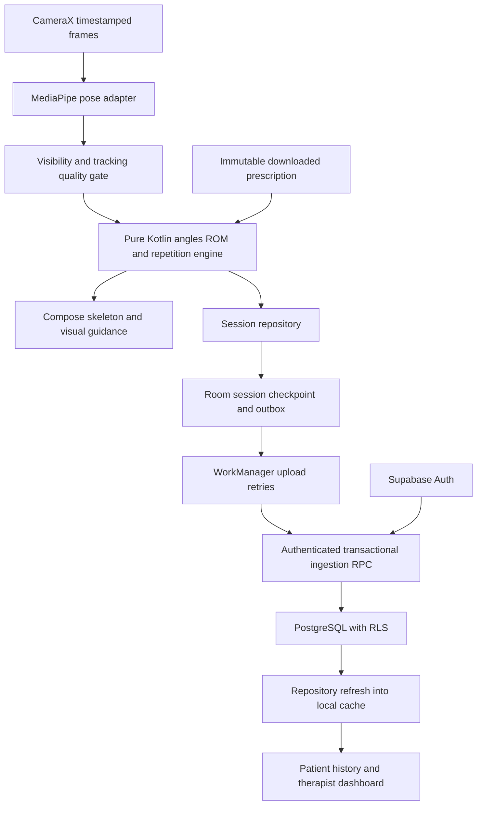
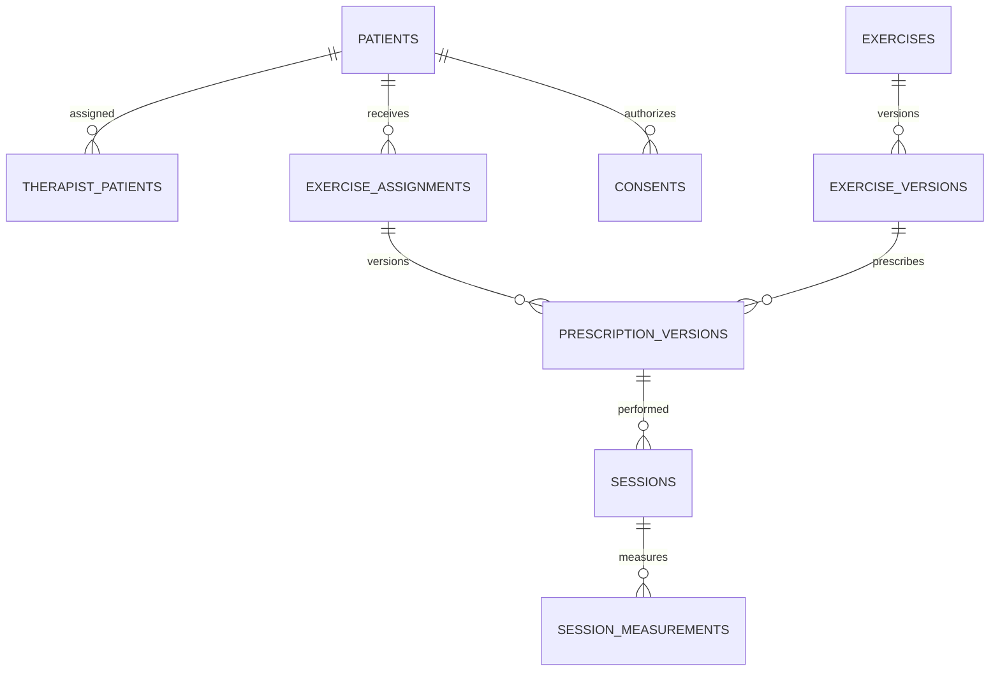

# Motivance implementation plan

Build an Android rehabilitation support application in Kotlin, with a feature-complete MVP by week 8 and a validated live pilot by week 10. The live camera view displays a skeleton, estimates joint angles and range of motion (ROM), counts repetitions and compares movement against therapist-defined prescriptions. The application supports professional review; supported measurements must pass a predeclared validation protocol.

Implementation instruction: therapist review and physical-device validation are deferred follow-up work, not blockers to implementing Sprints 2 and 3. The executable development catalogue supports elbow flexion and shoulder abduction now. Record later reference/device/therapist checks in [POST-IMPLEMENTATION-CHECKLIST.md](validation/POST-IMPLEMENTATION-CHECKLIST.md); do not represent deferred checks as executed clinical validation.

S3 now implements the connected workflow: password-independent patient invitations, scoped link revocation, immutable prescription publishing, cached assigned-session launch, durable WorkManager uploads with server idempotency, separate consent events, privacy requests and audit records. The supplied `android/app/MotivanceLogo.png` is preserved and copied into `res/drawable-nodpi/motivance_logo.png` for native headers and the adaptive launcher icon. See [S3 implementation](validation/SPRINT-03-IMPLEMENTATION.md) and [environment configuration](operations/ENVIRONMENT.md).

Email/password signup requires an emailed confirmation code. Recovery verifies a recovery code before setting a new password; the Android auth screen supports resending codes and localized invalid-code, unconfirmed-email, rate-limit and password-policy feedback. Supabase Auth owns delivery and token validation. Six-digit codes expire after ten minutes. Backend SMTP settings belong in ignored `supabase/.env` (public template `supabase/.env.example`), separate from public Android build configuration. The setup script supports local Docker and hosted Auth; Gmail TLS authentication and local Docker SMTP configuration have passed, while inbox delivery and hosted configuration remain pending. See [Auth email setup](operations/AUTH-EMAIL.md).

## Documentation and planning ownership

UI/UX basis: use `stitch_galawgo_rehabilitation_system_prototype/` and its `kinetic_clinical_precision/DESIGN.md` as the visual and interaction reference for Kotlin Compose. Preserve Motivance branding. Translate its navy/teal clinical palette, rounded cards, spacing, typography hierarchy and patient/therapist screen flows into native components; do not ship the prototype HTML in a WebView. Adapt layouts for large text, readable contrast, 48dp or larger targets, English/Filipino resources and supported phone sizes. Reference role selection, camera positioning and real-time assessment in Sprint 1; use the patient/therapist dashboards, prescriptions, results and progress screens in their scheduled sprints. Prototype content is sample data, never evidence of implemented or validated behavior.

The native role, dashboard, exercise/patient list, progress/profile, prescription-form and camera-flow layouts follow the supplied prototype. Authentication uses a shared navy/teal loading, sign-in, patient-signup and email-recovery design with localized status feedback, keyboard-aware scrolling and password visibility controls. Session restoration has an explicit loading state; no artificial startup delay or new authentication provider is added. S3 implements prescription writes and connected uploads. S4 adds patient-scoped history/charts, authenticated administration, bilingual language selection, lifecycle/performance hardening and release-preparation documentation. See `docs/architecture/UI-UX.md` for the current functional/visual boundary.

Store all new project documents, architecture decisions, evaluation reports and operational guides in `docs/`. The explicit exception is the executable sprint backlog: keep `sprints/config.json` and the five flat `sprints/sprint-01.json` through `sprint-05.json` files at the repository root. Keep implementation scripts in `scripts/` and executable CI configuration in `.github/workflows/`. The root README is an entry-point link to documentation.

This document owns scope, architecture, database and dependency decisions. Sprint JSON owns issue status, acceptance evidence and completion. Do not recreate `docs/planning/backlog.json` or maintain another copy of the backlog. Describe changes to architecture here and update affected sprint records in the same change. Preserve existing imported design assets as reference material; their HTML is not the Kotlin application.

Source requirements: local `Motivance.pdf`, objectives pp. 4-5, functional requirements pp. 6-9 and nonfunctional requirements pp. 10-13. [GitHub plan #1](https://github.com/fsco101/Motivance/issues/1) tracks delivery. The sprint milestones and existing MOT issue IDs remain stable.

## Scope, delivery and capacity

Assume three to four active contributors sharing Android, computer vision, backend and QA responsibilities, with therapist input from week 1 and access to two representative Android phones. Confirm actual availability at kickoff. Story points are relative estimates, not person-days. Reserve about 20% of actual capacity for integration and defects; re-estimate after Sprint 1.

MVP includes patient, therapist and basic administrator screens in one Android application; secure sign-in and recovery; therapist-patient assignments; a small therapist-approved exercise set (target two or three); camera setup; live skeleton; angles, ROM, repetitions and duration; supported form feedback; immutable prescriptions; offline session recording; safe upload retries; history and progress charts; English/Filipino critical flows; consent and audit events.

Defer iOS, a separate web dashboard, video consultations, raw video archives, custom model training, arbitrary exercise recognition and automatic diagnosis. Each new exercise needs its own camera geometry, angle conventions and evidence; adding catalogue data does not automatically implement a new movement algorithm.

| Sprint | Weeks | Delivery and acceptance gate | Existing issues |
|---|---|---|---|
| S1 | 1-2 | Therapist approves exercises and protocol; app foundation, schema/RLS and live skeleton work on target phones | MOT-01 through MOT-06 |
| S2 | 3-4 | Reliable ROM/repetition engine, quality gates, live guidance, local persistence and early accuracy report | MOT-07 through MOT-12 |
| S3 | 5-6 | Therapist prescribes; patient completes offline; results upload once and remain isolated by patient | MOT-13 through MOT-18 |
| S4 | 7-8 | History/charts, basic admin, bilingual usability, interruption recovery and MVP acceptance | MOT-19 through MOT-24 |
| S5 | 9-10 | Final accuracy/device/security evidence, defect resolution, production release and handover | MOT-25 through MOT-30 |

At each sprint kickoff, assign owners and confirm prerequisites. During week one, implement contracts and the riskiest behavior first. During week two, integrate and demonstrate the vertical workflow. Review dependency blockers midweek. A sprint completes only after its acceptance records and demo evidence are reviewed. An eight-week final release is a stretch outcome requiring the same release gates as week 10; feature completeness alone is insufficient.

Critical path: exercise protocol and camera feasibility -> measurement engine -> guided local session -> versioned assignment integration -> retry-safe upload -> therapist review -> final validation -> defect gate -> deployment. Schema/auth work proceeds alongside the camera spike. Start external distribution verification in Sprint 1 and finish configuration in Sprint 4; store approval timing is external.

## Programming languages and toolchain

| Concern | Decision |
|---|---|
| Android application, UI and CV orchestration | Kotlin, Jetpack Compose, coroutines and StateFlow |
| Angle, ROM and repetition engine | Pure Kotlin, independent of Android and MediaPipe |
| Build configuration | Gradle Kotlin DSL, version catalogue and checked-in Gradle wrapper |
| Central persistence | PostgreSQL SQL migrations, RLS and transactional functions in Supabase |
| Local persistence | Room over SQLite; Room migrations and schema exports |
| Optional privileged backend operations | Supabase Edge Functions in TypeScript only when needed; no separate inference server |
| Planning synchronization | Existing Python standard-library script and GitHub CLI |

Start with minimum Android API 26 as a proposed baseline, then confirm the client device inventory in MOT-01. Supabase's Kotlin installation guidance identifies API 26 as its baseline without additional desugaring. Confirm compatibility across MediaPipe, CameraX, Room and the selected SDK. Choose compile/target SDK to satisfy the distribution requirements at release. Select the JDK required by the pinned Android Gradle Plugin, then document the tested JDK/AGP/Gradle/Kotlin/KSP tuple; do not choose those versions independently. [Supabase installation](https://supabase.com/docs/reference/kotlin/installing)

## Packages and dependencies

The implemented subset is pinned in `android/gradle/libs.versions.toml`, with a checked-in Gradle wrapper. S2 adds Room 2.8.5 through KSP2; S3 adds WorkManager 2.10.5 and a native Android Keystore AES/GCM session vault. See `docs/operations/DEVELOPMENT.md` for the tested toolchain. The OkHttp GoTrue/PostgREST adapter implements both `AuthRepository` and `RehabilitationRepository`, with protected token restoration and one automatic refresh on an authenticated 401. No second HTTP stack is added. Avoid dynamic versions such as `latest.release`. Compose and Supabase BOMs align their own libraries; they do not align the entire toolchain.

| Capability | Gradle coordinates or plugin | Placement and use |
|---|---|---|
| Android and Kotlin | `com.android.application`, `org.jetbrains.kotlin.android`, `org.jetbrains.kotlin.jvm` | App and pure Kotlin modules |
| Compiler support | `org.jetbrains.kotlin.plugin.compose`, `org.jetbrains.kotlin.plugin.serialization`, `com.google.devtools.ksp` | Match selected Kotlin/compiler processor compatibility |
| Compose | `androidx.compose:compose-bom`, `androidx.compose.ui:ui`, `androidx.compose.foundation:foundation`, `androidx.compose.material3:material3` | UI, skeleton drawing and accessible controls |
| Activity/lifecycle | `androidx.activity:activity-compose`, `androidx.lifecycle:lifecycle-viewmodel-compose`, `androidx.lifecycle:lifecycle-runtime-compose` | ViewModels and lifecycle-aware state collection |
| Navigation | `androidx.navigation:navigation-compose` | Role routing, auth links and feature screens |
| Async/state | `org.jetbrains.kotlinx:kotlinx-coroutines-core`, `org.jetbrains.kotlinx:kotlinx-coroutines-android` | Domain flows and app threading |
| JSON | `org.jetbrains.kotlinx:kotlinx-serialization-json` | Typed API DTO serialization |
| Camera | `androidx.camera:camera-camera2`, `camera-lifecycle`, `camera-view` in the same group | Capture, lifecycle binding and PreviewView through Compose interop |
| Pose model runtime | `com.google.mediapipe:tasks-vision` | On-device landmarks; add a compatible pose `.task` model asset separately |
| Local database | `androidx.room:room-runtime`, `androidx.room:room-ktx`, `androidx.room:room-compiler` via KSP | Use one compatible stable Room family; export/test migrations |
| Persistent uploads | `androidx.work:work-runtime-ktx` | Outbox draining, network constraints and retry/backoff |
| Preferences | `androidx.datastore:datastore-preferences` | Language and setup preferences; not patient records or unprotected secrets |
| Dependency injection | `com.google.dagger:hilt-android`, `com.google.dagger:hilt-compiler`, `com.google.dagger.hilt.android` plugin | Application bindings and ViewModels; use one supported processor setup |
| Supabase | `io.github.jan-tennert.supabase:bom`, `auth-kt`, `postgrest-kt` | Identity and authenticated SQL API/RPC; Kotlin client is community-maintained |
| HTTP engine | `io.ktor:ktor-client-okhttp` | Engine compatible with the chosen Supabase/Ktor versions |
| Unit tests | `junit:junit`, `org.jetbrains.kotlinx:kotlinx-coroutines-test` | Deterministic measurement traces, state machines and repository behavior |
| Android tests | `androidx.test.ext:junit`, `androidx.test:runner`, `androidx.compose.ui:ui-test-junit4` | Instrumented UI/permission/lifecycle flows |
| Persistence tests | `androidx.room:room-testing`, `androidx.work:work-testing` | Schema upgrades, atomic saves and background upload behavior |

Add `androidx.hilt:hilt-work` and its matching compiler only if workers use Hilt integration. Add Supabase `functions-kt` only if privileged functions are implemented. `storage-kt` is optional for approved media assets; `realtime-kt` is unnecessary for the initial metrics workflow. Use Compose Canvas for the skeleton and simple trend charts initially. OpenCV, Python ML servers, cloud GPUs and a second inference runtime are not required for the baseline.

Select the lite or full pose model based on measured accuracy/latency on target phones. Record its origin, licence, checksum and model version; bundle it so downloaded instructions and inference work offline. [MediaPipe Android setup](https://developers.google.com/edge/mediapipe/solutions/vision/pose_landmarker/android)

Dependency references: [Compose BOM](https://developer.android.com/develop/ui/compose/bom), [Room releases and setup](https://developer.android.com/jetpack/androidx/releases/room), [Hilt setup](https://developer.android.com/training/dependency-injection/hilt-android), [persistent work](https://developer.android.com/develop/background-work/background-tasks/persistent), [Supabase Kotlin modules](https://supabase.com/docs/reference/kotlin/installing). Review versions at Sprint 1 rather than treating documentation examples as a tested combination.

## System architecture



Run pixel conversion and inference off the main thread; serialize the lightweight assessment engine and UI commands on the main thread and draw only the latest coherent result. Use backpressure rather than queueing stale frames. Transform landmarks for rotation, preview crop and mirroring before drawing. Choose each exercise's 2D/estimated-3D angle convention explicitly. Reject low-confidence/degenerate samples before updating valid ROM extrema or repetition state. A lost skeleton suspends measurement updates and asks the user to reposition.

Use hysteresis and minimum-duration rules for full movement cycles. Store completed and incomplete repetitions separately. Display target reached only when the current valid sample satisfies the prescribed rule. Keep model output, assessed angle, filtering delay and tracking quality distinguishable. The skeleton is a visualization of estimated landmarks, not a reference measurement.

Room is the local source of recorded sessions and cached assignments; repositories refresh assignments from authorized cloud data. The shared therapist/patient history dashboard is an online, in-memory read with fresh server authorization, separate from owner-scoped local history. Changing account/filter or a failed history request clears displayed records. Pin a prescription version at session start. Atomically save session completion and an outbox record, upload with the same UUID on retry, and acknowledge only after a server transaction succeeds. Never merge new prescription targets into an active or historical session. Interrupted drafts remain interrupted until explicitly resumed or discarded.

History reads use existing RLS-protected session/prescription/exercise/measurement tables; no SQL migration, privileged key or chart library is required. Require one patient per query and use 50-record keyset pages ordered by UTC start time and UUID, with one lookahead record. Inclusive calendar dates use UTC midnight through the next day exclusively. Read every child metric and the session's referenced prescription, including old targets when an assignment changes. Charts separate patient, exercise version, side, prescription version, metric, model and algorithm. Draw only completed sessions with valid finite ROM and positive valid-frame counts; limited/invalid/interrupted/missing samples leave gaps. Chart positions follow session order, not elapsed time. The loaded-record count and explicit older-page action bound what the chart claims to summarize. See [MOT-19 evidence](validation/SPRINT-04-HISTORY.md).

## Required database design

The live camera screen now places `MeasurementControls` (explicit consent/Start, preview/recording/paused status and phase-specific return/reach guidance) above SkeletonPreview. Camera preview alone never starts repetition collection. Pause measurement can retain the preview while discarding the unfinished cycle. Demo counting remains debug-only and LOCAL_ONLY; the same assessment engine handles prescribed results. The renderer, model, thresholds, repetition rules, Room schema and upload contracts are unchanged by this clarification. See [live assessment troubleshooting](operations/LIVE-ASSESSMENT-TROUBLESHOOTING.md).

Therapists can set an optional `focus_joint` in immutable prescription `parameters` (SHOULDER/ELBOW/WRIST/HIP/KNEE/ANKLE), using the prescription's anatomical side. `BodyJoint` provides explicit landmark/chain mappings; `ExerciseRules.focusJoint` is pinned through cache, draft recovery and upload. The presentation labels visual focus separately from the algorithm's measurement joint. Existing supported algorithms remain elbow flexion/shoulder abduction; focus selection does not add another assessment. Migration `202611010004_prescribed_focus.sql` validates allowed parts and session/prescription agreement while accepting legacy default-focus payloads. Room remains v2; optional JSON decoding preserves legacy defaults without rewriting queued payloads. See [prescribed focus operation](operations/PRESCRIBED-FOCUS.md).

Live skeleton presentation is isolated in `app/.../feature/exercise/SkeletonPreview.kt`. It shares the existing PreviewMapping transform with the camera bitmap, highlights the selected anatomical exercise chain, and displays quality-aware angle/repetition tiles. This adds no model/dependency, storage schema, network API or assessment-rule change. See [overlay refinement evidence](validation/SKELETON-OVERLAY-REFINEMENT.md).

S4 administration is implemented in `202611010002_administration.sql`; `202611010003_localized_catalogue.sql` appends bilingual development definitions without rewriting earlier versions. Administrator RPCs check the current active role, serialize account/role/link changes, reject self-role/status modification, revoke links/assignments when a therapist role is removed, and audit changes. Catalogue instruction edits append immutable versions of existing supported algorithms; they cannot introduce unimplemented algorithms. The Android `feature/admin/` ViewModel uses `AdministrationRepository` through the same authenticated OkHttp adapter and public client key. Account-directory pagination uses 50 rows plus lookahead; links/catalogue currently have explicit 500/100-row bounds. No privileged key or separate admin service is shipped.

S4 keeps the existing dependency tuple. Downloaded bilingual instructions retain both authored languages offline, including after a language change; legacy English-only versions remain unchanged. A non-sensitive `appearance` SharedPreferences file persists the language override; Activity context localization supplies English/Filipino resources. No clinical data or tokens enter this preference. Room remains v2. Camera analysis remains on its executor with a bounded one-frame UI handoff; callbacks after disposal/backgrounding are ignored. A lifecycle revision cancels a delayed Start after interruption. Severe thermal status pauses collection/releases camera resources; unavailable thermal telemetry does not reject a device. The existing provisional 250ms p95 threshold produces a warning after at least 60 samples, not a validated phone-eligibility gate. Device performance and clinical accuracy remain deferred follow-ups. Production preparation and current Play/API/native-runtime dependencies are in [PRODUCTION-READINESS.md](operations/PRODUCTION-READINESS.md); target API 35 is not claimed ready for current API-36 Play submissions.

Use **PostgreSQL through Supabase** for shared, relational records and **SQLite through Room** for local state. Supabase is the hosting/auth/API platform, not a separate database engine. Redis, MongoDB, a vector store and a time-series service are unnecessary for the initial scope. Keep binary media in private object storage only when justified; never put video blobs in database rows.

### PostgreSQL tables

| Table | Primary relationships and fields | Integrity and access rule |
|---|---|---|
| `auth.users` | Supabase-managed identity | Do not duplicate credentials in public tables |
| `profiles` | `id` references auth user; display name, locale, active flag | User reads own profile; protected fields changed only through trusted operations |
| `user_roles` | user ID plus patient/therapist/admin role | Server-controlled membership; users cannot self-promote |
| `patients` | patient UUID, unique user ID, minimal therapist-approved profile | Minimize collected clinical fields; patient-scoped RLS |
| `therapist_patients` | therapist ID, patient ID, active interval, assigned by | Trusted link management; one active link per pair |
| `exercises` | stable code, joint definitions, camera setup, supported sides, active flag | Catalogue identity; deactivate instead of deleting referenced definitions |
| `exercise_versions` | exercise ID, version, algorithm key, measurement convention, model/rule metadata, localized instructions | Immutable published definitions; unique exercise/version |
| `exercise_assignments` | patient ID, prescribing therapist, active state, current version reference | Patient reads; assigned therapist writes permitted prescriptions |
| `prescription_versions` | assignment ID, exercise version ID, side, degree thresholds, target repetitions, duration/form rules, author and timestamp | Immutable; edits create a new version; validated rule schema |
| `sessions` | client UUID, patient ID, prescription version ID, start/end, status, model/algorithm/app versions | Ownership must match prescription; stable idempotency key |
| `session_measurements` | session ID, metric key, joint/side, min/max/ROM degrees, completed/incomplete counts, quality summary | Unique metric per session; child policy follows authorized parent |
| `consents` | patient ID, consent type/version, granted/withdrawn timestamps | Append history; camera permission does not equal data consent |
| `audit_events` | actor, action, target type/ID, timestamp, minimal change metadata | Trusted append; no patient/client edits or token/raw-video logging |

Allow measurements for multiple tracked joints without duplicating session identity. Prefer explicit typed columns for primary metrics and targets. Reserve JSONB for versioned exercise-specific configuration and quality summaries validated against a known schema. Optional repetition detail can be added after a demonstrated review need; per-frame pose storage is excluded by default.

Use UUID keys, `timestamptz` in UTC, explicit units and side enums/checks. Enforce valid status transitions, nonnegative counts/durations, finite angle values and clinically approved per-exercise ranges. Do not hard-code all joints to 0-180 degrees. Add indexes on active therapist-patient links, assignment patient/status, sessions patient/start time and child session IDs; index policy lookup keys. Use composite constraints or transactional validation to prevent a session referencing another patient's prescription. Keep historical model and rule provenance reproducible.



RLS must protect every patient-bearing table, including child measurements and linked views. Test anonymous access, patient A/B, assigned/unassigned therapists and administrators through direct API requests. Account provisioning, role assignment and invitation operations run through a trusted backend. Never ship a database password or service-role key in the APK. Use private storage policies if storage is introduced.

### Local Room tables and synchronization

Current S3 database version is **2**, with `SessionMigrations.FROM_1_TO_2`, both exported schemas and a file-backed migration test. `consent_events` stores durable owner-scoped grant/withdrawal events; `local_sessions` pins the grant ID; `sync_outbox` adds attempts/error state; `cached_prescriptions` adds its download timestamp. Existing S2 `PENDING` payloads have no durable consent event and migrate to `REVIEW_REQUIRED`; they are retained without retroactive upload. New completed prescribed results use payload schema 2. Consent is uploaded before its dependent session, and a stored payload never changes on retry.

`SessionSyncWorker` runs with connected-network constraints and 30-second exponential backoff, with at most eight transient attempts per item. A 401 waits for sign-in; permanent 4xx validation/access/conflict errors remain rejected; only a matching server acknowledgement marks an item `SYNCED`. Explicit Sync retries exhausted/auth-waiting items; periodic 15-minute work covers process termination between database commit and enqueue. Work is scoped by owner; restored encrypted credentials must match that owner before any upload. A server advisory lock, canonical payload hash and a single PostgreSQL transaction prevent duplicate or partial parent/child writes. No background token or password is placed in `.env`.

The S2 paragraphs below describe its original baseline. In current S3, prescribed outbox entries upload through the worker; authentication restores through the backup-excluded Keystore vault. Supported downloaded prescription timing/form parameters are read from the immutable version's `parameters` JSON rather than merged into an active session. Development catalogue publication is not a clinical-approval claim.

S2 implementation: `SessionDatabase` v1 contains `cached_prescriptions` (owner/version key, pinned rules, instructions, 24-hour expiry), `local_sessions` (UUID, owner, immutable rules, aggregate checkpoint, draft/interrupted/completed state) and `sync_outbox` (session UUID key/FK, owner, payload and state). Exported schemas live in `android/app/schemas/`. The following entities describe the fuller S3 synchronization design; they are not additional implemented tables. S1 had no Room database, so v1 is a new database; future upgrades require migrations rather than destructive fallback.

`ExerciseSessionViewModel` feeds the pure `MovementAssessment` engine, checkpoints at most twice per second and on interruption, and completes session/outbox in one Room transaction. Recovery preserves totals/extrema/reason counts but discards a partial cycle, requires fresh calibration, and never auto-resumes. Demonstration thresholds are debug-only and their outbox state is `LOCAL_ONLY`. Downloaded supported patient prescriptions use pinned server versions; their outbox is `PENDING`. No S2 upload worker sends either payload. Auth tokens remain memory-only: a cold-start clinical session still needs online sign-in. See [S2 implementation and geometry](validation/SPRINT-02-IMPLEMENTATION.md).

| Local entity | Purpose |
|---|---|
| `CachedAssignment` / `CachedPrescriptionVersion` / `CachedExerciseVersion` | Downloaded, user-scoped instructions and immutable targets with freshness/expiry metadata |
| `SessionDraft` | Checkpoint state, valid extrema, repetition state and interruption status |
| `LocalSession` / `LocalMeasurement` | Completed result retained until acknowledged and through the approved local retention period |
| `SyncOutbox` | Unique session ID, payload version/hash, pending/retry/rejected/acknowledged state, attempt count and last error |

Outbox uniqueness is per session. Server ingestion validates authenticated ownership and accepts identical retries once; a reused UUID with a conflicting payload is rejected rather than silently replacing the result. Validate and insert the session and measurements in one transaction. Authentication errors wait for sign-in, transient errors back off, permanent validation failures become actionable errors. Store and show pending/failed/synced status.

Protect local records with app-private storage, exclusion of sensitive caches from device backup, user isolation and an explicit sign-out/retention policy. Persist tokens only through a reviewed protected session store; DataStore and Room do not provide encryption by themselves. Evaluate encryption needs during the security issue. A disconnected phone cannot immediately learn a revocation: define cache validity and explain that limitation in the pilot policy.

Create versioned SQL migrations under `supabase/migrations/`, use synthetic seeds, export Room schemas, and test upgrades. Development and production use separate configurations. Include a synthetic backup restore drill before release and document remote/local/backup retention and deletion behavior. No live patient data should be used in CI fixtures.

## Planned folder structure

The frontend is the native Android app in `android/`: Compose screens and theme are under `app/src/main/java/com/motivance/feature/` and `designsystem/`, with Android resources under `app/src/main/res/`. Camera, pose detection and the `core/` modules also execute on the phone. The backend implementation is under `supabase/`: database tables, authorization policies and SQL functions in `migrations/`, development configuration in `config.toml`, synthetic data in `seed.sql`, email templates in `templates/`, and database tests in `tests/`. `supabase/functions/` is reserved for future Edge Functions; no custom function is implemented there yet. Supabase provides the running auth and REST services. The Kotlin `data/remote/` package is a frontend API client, and `scripts/` contains development automation rather than a deployed backend. `android/.env` and its safe template belong to the Android build; imported Stitch HTML is a design reference rather than the shipped frontend.

Sprint 1 implements a runnable Android build with Gradle settings/build scripts, wrapper and version catalogue. The three modules are `:app`, `:core:domain` and `:core:assessment`; packages keep features separate. Later-sprint feature folders remain placeholders. Extract additional modules only when an actual dependency/build boundary requires it.

```text
Motivance/
  android/
    app/src/main/
      java/com/motivance/
        di/                       # Application composition and bindings
        navigation/               # Role routing and deep links
        designsystem/             # Accessible reusable Compose UI
        data/
          local/                  # Room entities, DAOs and mapping
          remote/                 # Supabase DTOs and calls
          repository/             # Domain repository implementations
          sync/                   # WorkManager and outbox coordination
        vision/
          camera/                 # CameraX lifecycle and transforms
          pose/                   # MediaPipe adapter and landmark quality
        feature/
          auth/
          patient/
          exercise/               # Setup, overlay and live guidance
          rehabilitation/         # Connected assignments, history filters and charts
          therapist/
          admin/
      assets/models/              # Verified pose model asset
      res/values/                 # Default strings and resources
      res/values-fil/             # Filipino strings
    app/src/test/                 # App unit tests
    app/src/androidTest/          # Device/UI/lifecycle tests
    app/schemas/                  # Room exported schema history
    core/domain/src/main/kotlin/com/motivance/domain/
    core/domain/src/test/kotlin/
    core/assessment/src/main/kotlin/com/motivance/assessment/
    core/assessment/src/test/kotlin/
    gradle/                       # Version catalogue; wrapper created in S1
  supabase/
    migrations/                   # Tables, policies, functions and indexes
    functions/                    # Privileged operations only when needed
    tests/                        # SQL/RLS/transaction checks
    seed.sql                      # Created in S1 with synthetic data
    config.toml                   # Created in S1 by Supabase CLI
  docs/
    PLAN.md                       # Scope and architecture authority
    SPRINTS.md                    # Sprint maintenance and sync guide
    architecture/                 # Future ADRs and detailed database decisions
    validation/                   # Protocols and de-identified reports
    operations/                   # Build/deploy/restore/incident runbooks
  sprints/
    config.json
    sprint-01.json
    sprint-02.json
    sprint-03.json
    sprint-04.json
    sprint-05.json
  scripts/sync_sprints.py
  .github/workflows/sprint-sync.yml
```

`core:domain` owns immutable models, repository interfaces and use cases without Android or Supabase imports. `core:assessment` depends on domain models and implements angle math, quality rules, filters and repetition state machines without Android/MediaPipe imports. The app maps model outputs to domain landmarks and implements platform/storage/network adapters. Features call domain contracts and do not access other feature internals. Use ViewModels with immutable UI state and lifecycle-aware collection. Never add camera SDK types to the pure Kotlin engine.

## Validation, release and operational gates

In S1 agree angle conventions, positioning, reference instrument/procedure, sample/repetition counts, error and repeatability thresholds, allowed latency and unsupported-condition behavior with the therapist. Report results per exercise, joint/side and device. Do not choose error thresholds after observing model results. Run initial comparisons in S2 and repeat the final protocol on the release candidate in S5.

Meaningful checks cover known angle vectors, degenerate inputs, jitter and incomplete cycles, tracking loss, prescription version changes, offline retries after a server commit, process death, schema upgrades and RLS isolation. Device checks cover lower-spec and mid-range phones, full expected session duration, preview alignment, memory/thermal behavior and feedback latency. Assess ordinary operation response against the PDF's approximately three-second target under a documented network setup. Review large text, touch targets and feedback comprehension with representative users in English and Filipino.

Release requires no critical access, invalid-measurement, session-loss or core-task blocker; therapist-reviewed validation; successful backup restore; approved consent/retention handling; signed APK/AAB; production smoke test; and documented support ownership. Store submission and approval are distinct states. Do not mark a sprint done while external review or failed release gates remain undisclosed.

Planning budget remains approximately USD 25-50/month for a small metrics-only deployment, plus the earlier USD 25 one-time Play registration estimate; recheck current provider prices before purchase. Excludes labor, devices, taxes, SMS, clinical evaluation and extra environments. On-device inference avoids per-frame cloud processing costs. Add quota alerts and custom email delivery before the live pilot. No service purchases or production provisioning occur as part of this planning update.

## Completion workflow

Local development configuration is stored in ignored `android/.env`, with a credential-free `android/.env.example`. Generate it using `python scripts/setup_local_env.py` after starting the local Supabase stack. The Android build reads the emulator-specific endpoint and public client key; it never needs the service-role key. Database and live local-auth checks now pass; see `docs/validation/SPRINT-01-IMPLEMENTATION.md` for current evidence and physical/clinical acceptance still pending.

Use the evidence-based process in [SPRINTS.md](SPRINTS.md). The user's standing instruction is to close solved issues immediately and implemented sprint milestones when all their issues are resolved. Run `python scripts/sync_sprints.py --validate-only`, preview with `python scripts/sync_sprints.py`, then use `--apply` in the same work session. Completion requires engineering evidence, an accurately named reviewer and a timezone-aware timestamp. Explicitly user-deferred therapist/device checks remain false and linked to the follow-up checklist, with their nonblocking implementation disposition recorded. Failed engineering checks stay open. The sync workflow also runs after its changes are published to `develop` or `main`; implementation closure never establishes clinical validation or release readiness. See [closure review](validation/IMPLEMENTATION-CLOSURE.md).
